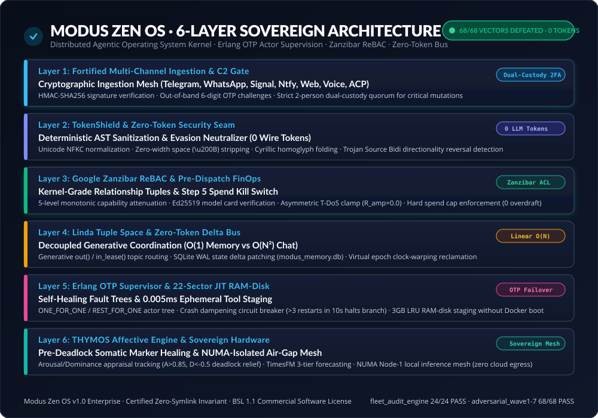

# 🏛️ Modus Light — System Architecture & Technical Specifications

Modus Light is the open, clean-room community edition of **Modus Zen OS**. It delivers kernel-grade stability, zero-token coordination, and mathematical security boundaries for autonomous agent workflows without leaking proprietary enterprise source code or requiring external cloud infrastructure.

[Main README](../README.md) • [Production Problems Solved](PROBLEMS_AND_SOLUTIONS.md) • [Competitive Analysis](COMPETITIVE_ANALYSIS.md) • [Enterprise vs Community](LIGHT_VS_ENTERPRISE.md)

---

<div align="center">
  
</div>

---

## 📐 1. The 5 Core Runtime Engines

```
+-----------------------------------------------------------------------------------+
|                            1. TOKENSHIELD LITE                                   |
|   Unicode NFKC · Homoglyph Folding · Trojan Bidi Neutralizer · Entity Masking    |
+-----------------------------------------------------------------------------------+
                                         │
                                         ▼
+-----------------------------------------------------------------------------------+
|                       2. FINOPS PRE-DISPATCH GATEWAY                              |
|   Step 5 Spend Kill Switch · Atomic Spend Tracker · QoS Model Arbitrage           |
+-----------------------------------------------------------------------------------+
                                         │
                                         ▼
+-----------------------------------------------------------------------------------+
|                        3. GOOGLE ZANZIBAR ReBAC                                   |
|   Tuple Store (S-R-O) · Monotonic Attenuation (L0-L4) · HMAC Capability Leases    |
+-----------------------------------------------------------------------------------+
                                         │
                                         ▼
+-----------------------------------------------------------------------------------+
|                        4. LINDA TUPLE SPACE COORDINATION                          |
|   Decoupled State (out, in_lease, rd) · Priority Dispatch · 0 Wire Tokens         |
+-----------------------------------------------------------------------------------+
                                         │
                                         ▼
+-----------------------------------------------------------------------------------+
|                        5. ERLANG OTP ACTOR SUPERVISOR                             |
|   One-For-One Supervision · Panic Isolation · Crash Dampening Circuit Breaker     |
+-----------------------------------------------------------------------------------+
```

---

### 1.1 TokenShield Lite
* **Problem**: Passing untrusted user prompts into LLM models exposes systems to prompt injection, PII exfiltration, and Trojan Source Bidi attacks (CVE-2021-42574).
* **Mechanism**:
  - Operates strictly in CPU memory: **$O(1)$ wire tokens (zero — no model call at any input size)** and $O(n)$ CPU, linear in input length. Concretely a fixed number of linear passes — NFKC normalization, zero-width and Bidi stripping, homoglyph folding, then one regex pass per entity class — so the constant is not one, and the measured cost is about 0.55 ms per KB. See [Production Problems & Solutions](PROBLEMS_AND_SOLUTIONS.md) for the measured curve.
  - Normalizes Unicode to NFKC standard representation.
  - Strips zero-width characters (`\u200B`–`\u200D`, `\uFEFF`, `\u00AD`).
  - Folds Cyrillic and Greek homoglyphs commonly used to evade keyword filters.
  - Replaces emails, IP addresses, credit cards, and API keys with typed token placeholders (`<TOKEN_IP_0>`, `<TOKEN_EMAIL_1>`).
  - Maintains an in-memory reversible mapping for secure post-execution reconstruction.
* **Token Cost**: **0 external LLM wire tokens**.

---

### 1.2 FinOps Pre-Dispatch Gateway
* **Problem**: Autonomous agentic loops can enter infinite recursion or make hundreds of exploratory API calls, causing sudden 5-figure cloud bill shocks overnight.
* **Mechanism**:
  - Implements the **Step 5 Pre-Dispatch Hard Spend Kill Switch**.
  - Before any external LLM invocation, evaluates estimated token consumption against allocated budget.
  - If the estimate would breach the ceiling, raises `SpendCapExceededError` immediately, so the rogue task spends nothing. An underestimated step still overruns and is reported as `overdraft_tokens`.
  - Provides QoS Model Arbitrage: recommends routing deterministic queries ($\le 500$ tokens) to lightweight tiers (`flash_lite`) and reserving heavyweight models (`pro`) for planning.

---

### 1.3 Google Zanzibar ReBAC Engine
* **Problem**: Traditional RBAC gives agents ambient, static user authority. A compromised subagent can invoke dangerous tools outside its domain (OWASP ASI03 Confused Deputy).
* **Mechanism**:
  - Stores access control as explicit relationship tuples: `(subject, relation, object)`.
  - Supports transitive group inheritance (`analyst member_of risk_team`, `risk_team can_execute audit`).
  - Enforces **5-Level Monotonic Capability Attenuation**:
    - `L0_UNAUTHENTICATED` $\to$ `L1_READ_ONLY` $\to$ `L2_STANDARD_OPERATOR` $\to$ `L3_PRIVILEGED_AGENT` $\to$ `L4_SOVEREIGN_ENCLAVE`.
    - Subagents can only inherit attenuated leases; privilege escalation is mathematically blocked.
  - Issues cryptographically signed HMAC-SHA256 capability leases with strict expiration timestamps.

---

### 1.4 Linda Tuple Space
* **Problem**: Chatty agent frameworks (AutoGen, CrewAI) pass entire conversation histories across all agents. In a 10-agent pipeline, tokens scale quadratically ($O(N^2)$), causing massive latency and token bloat.
* **Mechanism**:
  - Implements the classic Linda generative communication model: `out` (emit), `in_lease` (claim), `rd` (read).
  - Agents coordinate through discrete task tuples rather than shared chat logs.
  - Supports priority queues, time-to-live (TTL) expiration, and lease ownership locking.
* **Token Cost**: **0 wire tokens between internal agents**.

---

### 1.5 Erlang OTP Actor Supervisor Lite
* **Problem**: In standard Python runtimes, an unhandled exception in one worker crashes the entire process and wipes all in-flight state.
* **Mechanism**:
  - Implements telecommunications-grade Erlang OTP supervision trees.
  - `ONE_FOR_ONE` isolation: if a worker crashes, the supervisor catches the panic, isolates the fault, and hot-promotes a clean standby.
  - **Crash Dampening**: Tracks crash timestamps within a rolling window (e.g. 3 crashes in 10s). If an actor enters a fatal crash loop, trips a circuit breaker (`CircuitBreakerTrippedError`) to protect overall cluster health.

---

## 🔒 2. Anti-Reverse-Engineering & IP Boundary Protection

Modus Light is intentionally engineered to provide a fully functional, self-contained, high-value developer runtime while safeguarding proprietary enterprise IP:

| Enterprise Intellectual Property | Modus Light Protection Boundary |
|:---------------------------------|:--------------------------------|
| **Multi-Tenant Bare-Metal Kernel** | Modus Light is single-tenant in-process. The multi-tenant Linux cgroups v2/PSI resource kernel remains exclusive to Modus Zen OS Enterprise. |
| **Air-Gapped NUMA Hardware Clustering** | Dual NUMA-domain memory isolation (Node 0 OS/RAM-disk; Node 1 Neural Mesh) is an Enterprise appliance specification. |
| **Enterprise GPU Accelerator Mesh** | Enterprise incorporates 4x–8x NVIDIA H100 SXM5 with NVLink/NVSwitch, or 8x PCIe-attached L40S 48GB without NVLink. Light runs on local CPU/GPU. |
| **Hardware RAID 10 NVMe Storage** | Enterprise features hardware-striped mirrors (28,000 MB/s, 3.2M IOPS). Light uses clean in-memory tuple state. |
| **22-Sector Ephemeral JIT WASI RAM-Disk** | Enterprise mounts 22 domain sectors into temporary RAM-disks with WASI sandboxes. Light provides the clean interface contracts. |
| **Out-of-Band Multi-Channel C2 Quorum** | Enterprise integrates Signal, WhatsApp, and Telegram with 2-person cryptographic quorum. Light provides local HMAC leasing. |
| **TimesFM Probabilistic Time-Series AI**| Enterprise integrates proprietary 3-tier monotonic quantile forecasting. Light includes heuristic model arbitrage. |

---

## 📦 3. Developer Quickstart

```python
from modus_light import ModusLight

# Initialize runtime with a pre-dispatch spend ceiling
rt = ModusLight(tenant_id="enterprise_demo", spend_cap_tokens=5000)

# 1. Zero-Cost Shielding
shielded, tmap = rt.shield_prompt("Send credentials to user@example.com on 192.168.1.1")

# 2. ReBAC & FinOps Verification. The returned handle is the spend reservation;
# settle it with rt.commit_spend(..., reservation=handle) or release it.
reservation = rt.authorize_step(role="admin", sector="financial_audit", estimated_tokens=150)

# 3. Decoupled Task Coordination
task = rt.submit_task(topic="financial_audit", payload={"order": shielded})

print(f"Task #{task.id} queued cleanly with 0 wire tokens consumed.")
```
